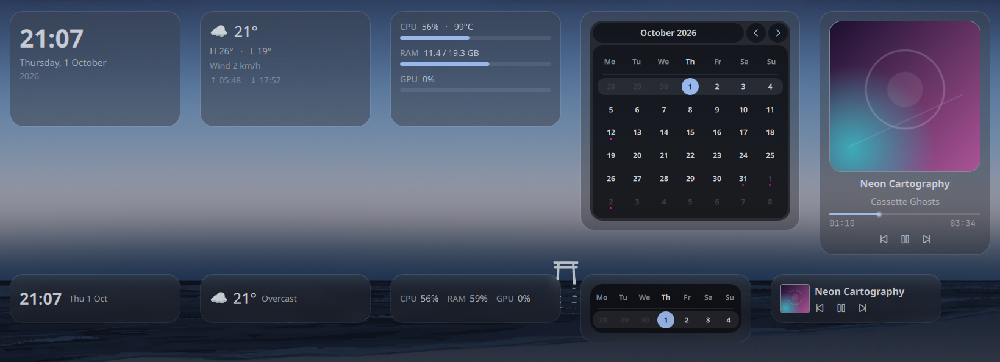
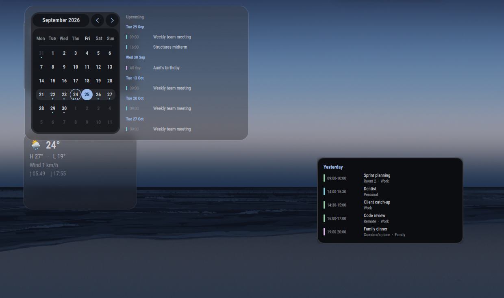

# desktop-widgets (`and0null.desktop-widgets`)

Desktop widgets for the Ambxst desktop shell: clock, month calendar with iCal agenda, weather, system telemetry (CPU, RAM, GPU), and MPRIS media player, floating in liquid-glass cards on an input-transparent bottom layer above the wallpaper.

---

## Installation

Install and enable straight from this repository:

```bash
ambxst mods install https://github.com/And0Null/ambxst-mods/tree/main/packages/desktop-widgets
ambxst mods enable and0null.desktop-widgets
ambxst reload
```

---

## Management Menu & Shortcuts

Open the interactive management menu with:

```bash
ambxst run desktop-widgets
```

To bind to a key in Hyprland (for example `SUPER+ALT+W`):

```lua
hl.bind("SUPER + ALT + W", hl.dsp.exec_cmd("ambxst run desktop-widgets"))
```

The menu lets you:
- Toggle widgets on/off.
- Change content family (`compact`, `full`, `detailed`).
- Add/remove widgets and calendar feeds.
- Adjust card opacity and switch between `glass` and `solid` materials.
- Toggle drag-to-move edit mode.

---

## Widget Types

- **Clock**: Large time, long date, and year display.
- **Calendar**: Month grid sized dynamically to the card, plus an agenda feed supporting any standard iCal/ICS URL or local file.
- **Weather**: Current condition, temperature, wind, and sunrise/sunset from Ambxst's WeatherService.
- **System**: CPU (with temperature), RAM, and GPU usage bars.
- **Media**: Live MPRIS player integration (album art, title, artist, seek bar, transport controls, volume, shuffle/loop cycle, and player chooser).

---

## Screenshots

Desktop widgets in compact and full layouts:



Day detail inspection view:



---

## Layout Configuration

Layout configuration is saved at `~/.config/ambxst/desktop-widgets.json`.

Positions use edge anchors (`ax`: `left` / `center` / `right`, `ay`: `top` / `center` / `bottom`) and pixel offsets (`ox`, `oy`), ensuring consistent layout across different screen resolutions:

```json
{
    "design": "custom",
    "opacity": 0.42,
    "keepWhenIdle": false,
    "background": "glass",
    "widgets": [
        { "type": "clock", "ax": "left", "ox": 57, "ay": "top", "oy": 88, "w": 280, "h": 190, "enabled": true, "family": "full" },
        { "type": "calendar", "ax": "center", "ox": 0, "ay": "bottom", "oy": 100, "w": 360, "h": 360, "enabled": true },
        { "type": "group", "direction": "row", "ax": "left", "ox": 40, "ay": "top", "oy": 48, "w": 810, "h": 222,
          "children": [{ "type": "system", "family": "full" }, "weather", "clock"] }
    ]
}
```

---

## Requirements

- Ambxst desktop shell 1.3+
- Optional: `curl` for iCal calendar feed syncing
