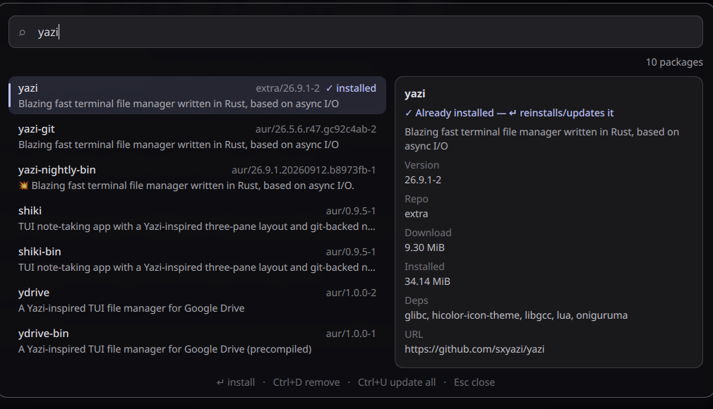
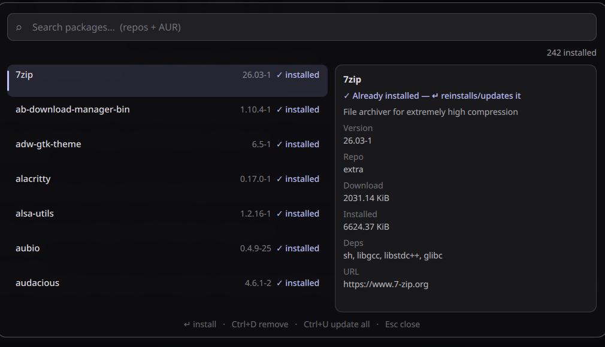
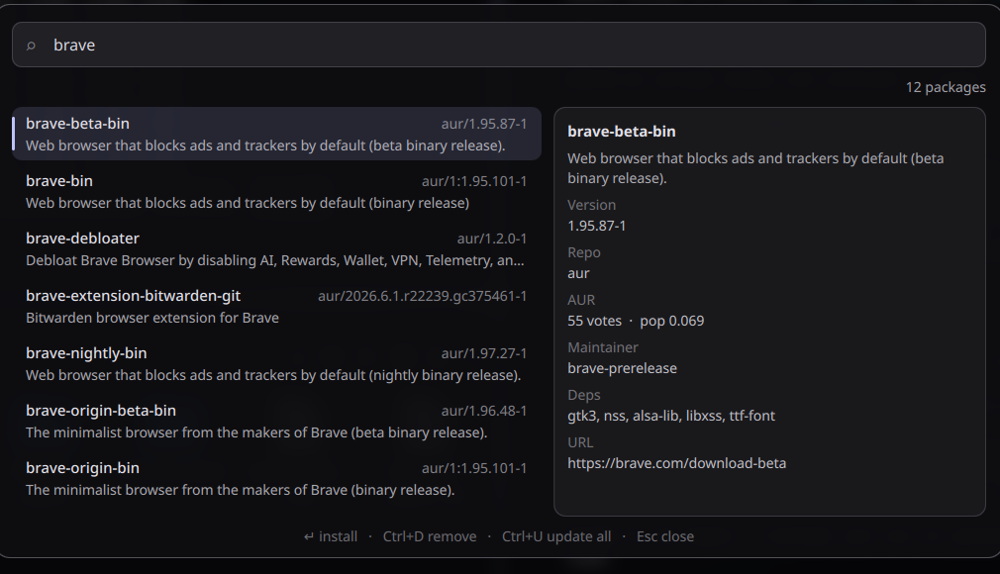

# pkg-launcher (`and0null.pkg-launcher`)

A pacseek-style package launcher for the Ambxst desktop shell: type to search the sync repos (`pacman`) and the AUR live, browse installed packages, and delegate install/remove/update workflows to an interactive terminal where your chosen AUR helper manages the sudo prompt.

---

## Installation

Install and enable straight from this repository:

```bash
ambxst mods install https://github.com/And0Null/ambxst-mods/tree/main/packages/pkg-launcher
ambxst mods enable and0null.pkg-launcher
ambxst reload
```

---

## Keybindings & Launch

Launch with the command:

```bash
ambxst run pkg-launcher
```

To bind to a shortcut in Hyprland (for example `SUPER+SHIFT+P`), add to your configuration:

```lua
hl.bind("SUPER + SHIFT + P", hl.dsp.exec_cmd("ambxst run pkg-launcher"))
```

Alternatively, copy `extras/Package Launcher.desktop` into `~/.local/share/applications/` to open from any application launcher.

---

## Configuration: AUR Helper

Select your preferred AUR helper (**paru** or **yay**) directly in:
**Ambxst Settings -> Mods -> Package launcher -> AUR helper**

1. Choose `paru` (default) or `yay`.
2. Reload the shell with `ambxst reload` to apply settings.
3. If the selected helper binary is missing from your system, the launcher shows an inline warning and keeps the official `pacman` repository search active.

---

## Features

- **Live search across repos and AUR**: Official repository results show instantly while AUR results merge asynchronously.
- **Relevance ordering**: Exact name -> name prefix -> substring match -> description matches. Alphabetical within each tier.
- **Package details pane**: Shows download/installed size and dependencies for repo packages; votes, popularity, maintainer, and out-of-date flags for AUR packages.
- **Installed and upgrade badges**: Status indicators showing installed packages and pending upgrades (`pacman -Qu` and `<helper> -Qua`).
- **Keyboard-first navigation**:
  - `Enter`: Install selected package in terminal.
  - `Ctrl+D`: Remove selected package.
  - `Ctrl+U`: System upgrade (`<helper> -Syu`).
  - `Up / Down`: Navigate list.
  - `Esc`: Close launcher.
- **Empty query mode**: Opening without a search query lists all explicitly installed packages.

---

## Screenshots

Search with details pane:



Browse installed packages:



AUR package details:



---

## Requirements

- `pacman`
- AUR helper: `paru` (default) or `yay`
- Optional: `zenity` or interactive terminal emulator (e.g. `foot`, `kitty`)

---

## Troubleshooting

- **Command not found / Keybind does nothing**:
  The mod registers its command at shell build time. Ensure the mod is enabled and the shell was reloaded:
  ```bash
  ambxst mods enable and0null.pkg-launcher
  ambxst reload
  ```

- **Upgrading from old package ID (`and00pium.pkg-launcher`)**:
  Reinstall using the current repository URL:
  ```bash
  ambxst mods remove and00pium.pkg-launcher
  ambxst mods install https://github.com/And0Null/ambxst-mods/tree/main/packages/pkg-launcher
  ambxst mods enable and0null.pkg-launcher
  ambxst reload
  ```
